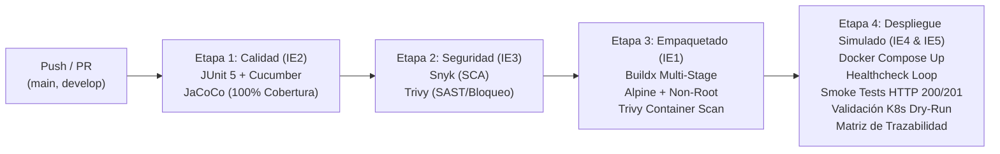

# Pagos — Microservicio de riesgo pagos

Microservicio correspondiente al **caso caso06 — ViajaMejor** (Reservas de viajes) para la asignatura **Ingeniería DevOps (DOY0101)** — Duoc UC.

| Dimensión | Detalle |
|---|---|
| **Asignatura** | DOY0101 — Ingeniería DevOps (Evaluación Parcial N°2) |
| **Ponderación** | 45% |
| **Stack** | Spring Boot 3.3.5 · Java 21 · Maven · Spring Data JPA · H2 · springdoc-openapi |
| **Calidad** | JaCoCo cobertura LINE 100% · Pruebas unitarias JUnit 5 · Cucumber BDD |
| **Seguridad** | Dependabot · Snyk · Aquasecurity Trivy (Quality Gate bloqueante) |
| **Contenedores** | Dockerfile Multi-stage · Alpine Linux JRE 21 · Usuario no-root |
| **Orquestación** | Docker Compose (límites y healthcheck) · Kubernetes (Deployment, Service, HPA) |
| **CI/CD** | GitHub Actions (`.github/workflows/ci-cd.yml`) con despliegue simulado y trazabilidad |

---

## Responsabilidad (SRP)

Administra los datos y la lógica del dominio de Pagos del caso **caso06 (ViajaMejor)**. Su base de datos es una **H2 en memoria** (un microservicio por base), cumpliendo aislamiento de datos por dominio.

## Página de presentación

Al ejecutar el servicio, `http://localhost:8080/` muestra la página de presentación del microservicio con documentación y enlaces a:

- **Swagger UI**: `/swagger-ui/index.html`
- **OpenAPI (json/yaml)**: `/v3/api-docs` / `/v3/api-docs.yaml`
- **ReDoc**: `/redoc.html`
- **H2 Console**: `/h2-console`

## Endpoints REST

| Método | Ruta | Descripción |
|---|---|---|
| `GET` | `/api/pagos` | Lista todos los pagos registrados |
| `GET` | `/api/pagos/{id}` | Obtiene un pago específico por ID |
| `POST` | `/api/pagos` | Registra un nuevo pago |
| `PUT` | `/api/pagos/{id}` | Actualiza un pago existente |
| `DELETE` | `/api/pagos/{id}` | Elimina un pago por ID |

---

## Documentación del proyecto

La documentación completa se ubica en la carpeta [`docs/`](docs/):

- [`docs/00_Resumen.md`](docs/00_Resumen.md) — Propósito, responsabilidad y tecnologías.
- [`docs/01_Arquitectura.md`](docs/01_Arquitectura.md) — Componentes, arquitectura y patrones.
- [`docs/02_API.md`](docs/02_API.md) — Contrato REST y ejemplos curl.
- [`docs/03_Pruebas.md`](docs/03_Pruebas.md) — Pruebas unitarias, cobertura JaCoCo 100% y Cucumber.
- [`docs/04_Despliegue.md`](docs/04_Despliegue.md) — Estrategias de contenerización, orquestación (Compose / K8s) y CD.
- [`docs/05_Justificacion.md`](docs/05_Justificacion.md) — Justificación técnica y arquitectura cloud.
- [`docs/diagramas/`](docs/diagramas/) — C4, diagramas de secuencia e infraestructura.

---

# Pipeline CI/CD en GitHub Actions (Evaluación Parcial N°2)

El pipeline de integración y entrega continua se implementa en [`.github/workflows/ci-cd.yml`](.github/workflows/ci-cd.yml) y automatiza el ciclo de vida completo del microservicio garantizando **calidad, seguridad, gobernanza y trazabilidad**.



### 1. Etapa de Pruebas Automatizadas y Cobertura (`test-and-coverage`) — IE2
- **Frameworks:** JUnit 5 y Cucumber (BDD) validando todos los flujos de negocio y endpoints.
- **Política de Calidad:** Verificación estricta de cobertura con **JaCoCo** configurado en `pom.xml` con regla de fallo ante una cobertura de líneas inferior al **100%**.
- **Artefactos:** Se publican los reportes de Surefire y JaCoCo HTML como evidencia persistente del build.

### 2. Etapa de Análisis de Seguridad y Vulnerabilidades (`security-scan`) — IE3
- **Dependabot (`.github/dependabot.yml`):** Monitoreo semanal de actualizaciones y vulnerabilidades en dependencias Maven, imagen base de Docker y flujos de GitHub Actions.
- **Snyk:** Escaneo de composición de software (SCA) en dependencias Maven (`--severity-threshold=high`).
- **Aquasecurity Trivy (Quality Gate Bloqueante):** Escáner de seguridad con política de fallo inmediata (`exit-code: 1`) ante vulnerabilidades **CRITICAL** o **HIGH**. Si se detectan vulnerabilidades no mitigadas, el pipeline se bloquea e impide avanzar al empaquetado y despliegue.

### 3. Etapa de Construcción y Optimización Docker (`docker-build`) — IE1
- **Multi-Stage Build:** Separa el entorno de compilación (Maven + Temurin 21) del runtime final.
- **Imagen Base Optimizada:** `eclipse-temurin:21-jre-alpine`, reduciendo el tamaño a menos de 180 MB y mitigando superficie de ataque.
- **Gobernanza y Privilegios:** Ejecución bajo usuario no privilegiado `appuser:appgroup` (UID/GID 10001).
- **Parámetros JVM en Contenedor:** `-XX:+UseContainerSupport -XX:MaxRAMPercentage=75.0`.
- **Escaneo de Imagen:** Trivy analiza la imagen generada antes de exportarla.

### 4. Etapa de Despliegue Simulado y Orquestación (`deploy-simulation`) — IE4 & IE5
- **Entorno Cloud Simulado:** Despliegue automatizado con `docker compose up -d`.
- **Healthcheck & Smoke Tests:** Sondeo activo hasta confirmar estado `healthy` y validación de endpoints HTTP (`GET /api/pagos`, `GET /v3/api-docs`, `POST /api/pagos`).
- **Validación Kubernetes:** Verificación de sintaxis, esquema y gobernanza de los manifiestos K8s mediante `kubectl apply --dry-run=client -k k8s/`.

---

# Trazabilidad y Gobernanza (IE4)

La trazabilidad desde el desarrollo hasta el entorno de despliegue se garantiza mediante los siguientes mecanismos:

1. **Etiquetado Semántico de Contenedores:**
   - Cada imagen generada se etiqueta con el hash del commit de Git: `duoc/jv0101-caso06-pagos:${{ github.sha }}` y la versión del release `duoc/jv0101-caso06-pagos:1.0.0`.
2. **Resumen de Ejecución (GitHub Step Summary):**
   - El pipeline publica automáticamente una tabla de auditoría con el Commit SHA, autor del trigger, rama, número de ejecución, resultado de pruebas de cobertura, estado de Quality Gate de seguridad y estado de los Smoke Tests.
3. **Inmutabilidad de Artefactos:**
   - La imagen Docker probada y validada en CI es la misma que se transfiere mediante artefactos y se despliega en el entorno simulado.

---

# Estrategia de Orquestación de Contenedores (IE5)

El proyecto ofrece dos niveles de orquestación listos para producción:

### Nivel 1: Docker Compose (`docker-compose.yml`)
- **Límites de Recursos:** Asignación de topes estrictos (`limits: cpus 1.0, memory 512M`) y reservas garantizadas (`reservations: cpus 0.25, memory 256M`).
- **Healthcheck Nativo:** Comprobación periódica con política de reintentos y tiempo de calentamiento (`start_period: 25s`).
- **Aislamiento de Red:** Red bridge privada `pagos-net`.

### Nivel 2: Kubernetes Manifests ([`k8s/`](k8s/))
- **Namespace dedicado:** `pagos-system` para aislamiento multi-tenant.
- **Alta Disponibilidad:** `Deployment` con 2 réplicas base y estrategia de despliegue `RollingUpdate` con cero tiempo de inactividad (`maxUnavailable: 0`, `maxSurge: 1`).
- **Gobernanza de Seguridad Pod/Contenedor (IE3):** `runAsNonRoot: true`, `allowPrivilegeEscalation: false`, capacidades del kernel revocadas (`drop: ["ALL"]`).
- **Sondeos de Salud (Probes):** `livenessProbe` para autorecuperación y `readinessProbe` para balanceo de carga.
- **Escalabilidad Elástica (HPA):** `HorizontalPodAutoscaler` que escala de forma automática de **2 a 5 réplicas** ante picos de demanda (70% CPU o 80% RAM).

---

## Cómo ejecutar localmente

```bash
# Compilar y ejecutar con Maven
mvn spring-boot:run
```

## Cómo ejecutar con Docker

```bash
# Construcción y levantamiento con Docker Compose
docker compose up --build
# Abrir http://localhost:8080
```

## Cómo desplegar en Kubernetes (Local o Clúster)

```bash
# Aplicar todos los manifiestos con Kustomize
kubectl apply -k k8s/

# Monitorear pods y HPA
kubectl get pods,hpa,svc -n pagos-system
```

## Cómo ejecutar las pruebas

```bash
mvn test      # Pruebas unitarias + Cucumber
mvn verify    # Pruebas + Verificación de cobertura JaCoCo (100% LINE, falla si baja)
```

---

## Elección y Justificación de ramificación

Como equipo hemos decidido implementar la estrategia GitFlow, siendo concientes de que en casos como estos desarrollos "pequeños y de cortos periodos de desarrollo para arreglos y funciones" sería teoricamente correcto usar Trunk-Based, pero existen 2 factores que marcaron el camino a la elección. 

En primer lugar está la experiencia previa al usar GitFlow, desde nuestros primeros proyectos en conjunto, lo hicimos usando esta estrategia, pero no solo porque nos lo enseñó nuestro profe, sino porque facilita y hace el desarrollo en conjunto más seguro. 

El segundo punto sería que precisamente por las dimenciones del proyecto y del equipo de desarrollo, se mitigan las principales carencias de la estrategia, como lo serían la alta dificultad al gestionar las ramas y los conflictos de fusión masivos con las ramas feature demasiado longevas.

Para dar conclusión a este apartado sintetizaremos la respuesta a que de tratarse de un proyecto serio y de tener un personal más abundante, la respuesta sería escojer Trunk-based, la cual favorece el desarrollo y entrega de feedback de manera agil. Pero en nuestro caso es más bien lo contrario, teniendo un equipo de solo 2 personas y un proyecto pequeño, por lo que nos resulta optimo usar GitFlow para el searrollo de este proyecto.

# Convenciones y Buenas Prácticas del Proyecto

## 1. Flujo de Trabajo (Git Workflow)
* **`main`:** Código principal o mejor conocido como "producción". Solo puede mezclarse con las ramas `develop` y o `hotfix/`.
* **`develop`:** Rama de desarrollo para integrar nuevas funciones o cambios de la rama main para la próxima versión.
* **Nomenclatura de ramas:**
  * `feature/ID-descripcion` (ej. `feature/evaluacion-2-pipeline-cicd`)
  * `bugfix/ID-descripcion`
  * `hotfix/ID-descripcion`

## 2. Convenciones de Commits
Seguimos el estándar de Conventional Commits:
* `feat:` Nueva funcionalidad o adición al proyecto.
* `fix:` Corrección del código.
* `docs:` Cambios o adiciones de la documentación.
* `chore:` Mantenimiento de configuración, dependencias o pipelines CI/CD.

## 3. Proceso de Revisión de Código y Pull Requests
* Ningún desarrollador debe hacer push directo a `develop` o `main`.
* Todo PR requiere al menos 1 revisor asignado.
* El pipeline CI/CD en GitHub Actions debe aprobar todas las pruebas y Quality Gates de seguridad antes de permitir el merge.
* Eliminar la rama temporal inmediatamente después del merge.

---

## 4. Declaración de Uso Ético de Inteligencia Artificial (IA)

En conformidad con las políticas académicas y la guía de uso de IA de Duoc UC ([https://bibliotecas.duoc.cl/ia](https://bibliotecas.duoc.cl/ia)):

- **Herramientas utilizadas:** Asistente de IA (Gemini).
- **Alcance y aplicación:** 
  1. Apoyo en la formulación y validación de sintaxis para los flujos de trabajo de GitHub Actions (`ci-cd.yml`) y manifiestos declarativos de Kubernetes (`k8s/`).
  2. Asistencia en la estructuración técnica de diagramas Mermaid y tablas de trazabilidad en Markdown.
- **Validación humana:** Toda la configuración, código, lógica del microservicio y políticas de gobernanza fueron revisadas, probadas y validadas directamente por el equipo de desarrollo, asegurando su perfecta correspondencia con los requerimientos de la evaluación.
- **Restricción estricta:** Las reflexiones individuales, análisis críticos y conclusiones fueron redactadas de manera personal y autónoma por cada integrante, sin uso de IA generativa.

---

## Reflexiones Finales e Individuales

### Evaluación Parcial N°1:
* **Sebastián Osorio:** Con esta primera entrega, en lo personal me deja con una sensación de satisfacción y optimismo, principalmente porque aprender las buenas prácticas de git, el uso correcto de las ramas y el uso de los pull request me significa una herramienta fundamental en mi repertorio para usarlo en el futuro cercano, afectando positivamente en mis futuros proyectos y en consecuencia, en la relación y convivencia con mis futuros compañeros de trabajo y mi carrera profesional.
* **Vicente Monsalves:** El proyecto está siendo interesante ya que pone a prueba lo que he aprendido en herramientas DevOps y eso representa un desafío grande al ser un nuevo proyecto, ya que pondrá a prueba qué tan bien soy capaz de ejecutar la consola de códigos y GitHub de una manera bastante distinta y más compleja a lo que anteriormente estoy acostumbrado.

### Evaluación Parcial N°2 (Encargo: Añadiéndole complejidad a nuestro pipeline):
***Sebastián Osorio:** Bueno profe, la verdad en esta entrega reviví un miedo que no quría volver a tener, los correos y notificaciónes del pipilines fallidos, pero con la ayuda de los videos, material y por su puesto la IA no fue taaan tedioso como las primeras veces que lo intenté en introducion a devops.

Pero también reconozco que fue gratificante una vez terminado y fue bien interesante la implementación de Snyk, es curioso la cantidad de vulnerabilidades que pueden haber, digo yo sabía que podrían haber unas cuantas, pero las que más recurrentes llegaron por los lados que no me esperé. Asi que, e resumen esta entrega reforzó conocimiento aprendido de pipelines y lo reforzó con la detección de vulnarabilidades, lo que reforzará mi desempeño y capacidad laboral y profesional.

 **Vicente Monsalves:** En lo personal Durante el desarrollo de esta segunda evaluación, mi trabajo estuvo enfocado principalmente en el área de pruebas automatizadas y la seguridad del microservicio. Me concentré en estructurar los casos de prueba unitarios con Pytest para validar tanto las operaciones principales del catálogo como las respuestas de error ante datos inválidos, asegurando que se cumpliera con el porcentaje de cobertura exigido en el pipeline.
 
  Asimismo, apoyé en la configuración y revisión del escaneo de dependencias mediante Dependabot y Bandit, lo que nos permitió entender cómo se detectan alertas de seguridad y cómo las reglas de bloqueo impiden que código vulnerable pase a la etapa de despliegue.

Asi que para ser mas especificos, esta unidad me permitió ver la otra cara de la industria, no solo la de armar un sistema, sino que la de mantenerlo en base a la constante busqueda de vulnarabilidades o fallos de diseño antes o después de poner la puesta en marcha.
