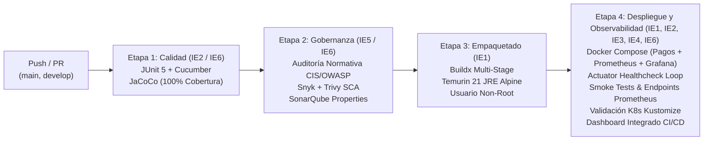

# Pagos — Microservicio de riesgo pagos

Microservicio correspondiente al **caso caso06 — ViajaMejor** (Reservas de viajes) para la asignatura **Ingeniería DevOps (DOY0101)** — Duoc UC.

| Dimensión | Detalle |
|---|---|
| **Asignatura** | DOY0101 — Ingeniería DevOps (Evaluación Parcial N°3: Observabilidad y entornos reales) |
| **Ponderación** | 30% |
| **Stack Base** | Spring Boot 3.3.5 · Java 21 · Maven · Spring Data JPA · H2 · springdoc-openapi |
| **Observabilidad (IE1)** | Spring Boot Actuator · Micrometer Prometheus · Servidor Prometheus v2.54.1 · Grafana v11.2.0 |
| **Orquestación Cloud (IE2)** | Kubernetes Manifests declarativos con Kustomize · Service y Pod Scrape Annotations · Probes Actuator |
| **Tableros / Dashboards (IE3)** | Dashboard interactivo en Grafana (`pagos-metrics-dashboard.json`) · Matriz en GitHub Step Summary |
| **Cumplimiento y Auditoría (IE5)** | Script automatizado de auditoría (`scripts/compliance-audit.sh`) · SonarQube · Branch Protection Rules |
| **Toma de Decisiones (IE4)** | Matriz técnica de escalabilidad elástica (HPA), alertas de resiliencia y prevención de fallas |
| **Mecanismo de Bloqueo (IE6)** | Quality Gates automatizados con fail-fast ante fallas de cobertura (100%), auditoría o despliegue |
| **CI/CD Pipeline** | GitHub Actions (`.github/workflows/ci-cd.yml`) con 4 etapas integradas de validación y despliegue |

---

## Responsabilidad (SRP)

Administra los datos y la lógica del dominio de Pagos del caso **caso06 (ViajaMejor)**. Su base de datos es una **H2 en memoria** (un microservicio por base), cumpliendo aislamiento de datos por dominio.

## Página de presentación y Observabilidad

Al ejecutar el servicio en `http://localhost:8080/`, se dispone de la interfaz interactiva con accesos directos a:

- **Página de Bienvenida**: `/`
- **Swagger UI**: `/swagger-ui/index.html`
- **OpenAPI**: `/v3/api-docs`
- **ReDoc**: `/redoc.html`
- **H2 Console**: `/h2-console`
- **Healthcheck Actuator**: `/actuator/health` (Liveness: `/actuator/health/liveness`, Readiness: `/actuator/health/readiness`)
- **Métricas Prometheus**: `/actuator/prometheus`
- **Métricas Generales Actuator**: `/actuator/metrics`

## Endpoints REST

| Método | Ruta | Descripción |
|---|---|---|
| `GET` | `/api/pagos` | Lista todos los pagos registrados |
| `GET` | `/api/pagos/{id}` | Obtiene un pago específico por ID |
| `POST` | `/api/pagos` | Registra un nuevo pago |
| `PUT` | `/api/pagos/{id}` | Actualiza un pago existente |
| `DELETE` | `/api/pagos/{id}` | Elimina un pago por ID |

---

## Documentación del proyecto

La documentación completa se ubica en la carpeta [`docs/`](docs/):

- [`docs/00_Resumen.md`](docs/00_Resumen.md) — Propósito, responsabilidad y tecnologías.
- [`docs/01_Arquitectura.md`](docs/01_Arquitectura.md) — Componentes, arquitectura y patrones.
- [`docs/02_API.md`](docs/02_API.md) — Contrato REST y ejemplos curl.
- [`docs/03_Pruebas.md`](docs/03_Pruebas.md) — Pruebas unitarias, cobertura JaCoCo 100% y Cucumber.
- [`docs/04_Despliegue.md`](docs/04_Despliegue.md) — Estrategias de contenerización, orquestación (Compose / K8s) y CD.
- [`docs/05_Justificacion.md`](docs/05_Justificacion.md) — Justificación técnica y arquitectura cloud.
- [`docs/06_Observabilidad.md`](docs/06_Observabilidad.md) — **Guía técnica completa de observabilidad, métricas, auditoría de cumplimiento normativo y toma de decisiones (Evaluación N°3).**
- [`docs/diagramas/`](docs/diagramas/) — C4, diagramas de secuencia e infraestructura.

---

# Pipeline CI/CD en GitHub Actions (Evaluación Parcial N°3)

El pipeline implementado en [`.github/workflows/ci-cd.yml`](.github/workflows/ci-cd.yml) automatiza el ciclo de vida completo del microservicio incorporando observabilidad, métricas, auditoría de cumplimiento normativo y compuertas de calidad bloqueantes:



### 1. Etapa de Calidad y Cobertura (`test-and-coverage`) — IE2 & IE6
- **Frameworks:** JUnit 5 y Cucumber (BDD) validando todos los flujos de negocio y endpoints.
- **Mecanismo de Interrupción (IE6):** Verificación estricta de cobertura con **JaCoCo** configurado en `pom.xml` al **100% de líneas**. Si la cobertura baja o un test falla, el pipeline aborta de inmediato.
- **Artefactos:** Publicación persistente de reportes Surefire y JaCoCo HTML.

### 2. Etapa de Cumplimiento Normativo y Seguridad (`compliance-and-security`) — IE5 & IE6
- **Auditoría Automatizada (`scripts/compliance-audit.sh`):** Ejecuta 12 reglas que auditan el cumplimiento de normativas CIS Docker Benchmark, NIST SP 800-190 y OWASP (usuario no-root, sondeos de salud, límites de CPU/RAM, PodSecurityContext, ausencia de secretos en código).
- **Quality Gate Bloqueante (IE6):** Si el script de auditoría detecta violaciones críticas, finaliza con código de error 1 y detiene el pipeline protegiendo el entorno productivo.
- **Análisis Estático y Dependencias:** Configuración `sonar-project.properties` para SonarQube, escaneo Snyk/Trivy y monitoreo continuo con Dependabot.

### 3. Etapa de Construcción y Empaquetado (`docker-build`) — IE1
- **Multi-Stage Build:** Separa el entorno de compilación (Maven + Temurin 21) del runtime final.
- **Imagen Base Optimizada:** `eclipse-temurin:21-jre-alpine`, reduciendo el tamaño a <180 MB y mitigando superficie de ataque.
- **Seguridad en Runtime:** Ejecución bajo el usuario no privilegiado `appuser:appgroup` (UID/GID 10001).
- **Healthcheck Integrado:** Comprobación nativa periódica hacia `/actuator/health`.

### 4. Etapa de Despliegue Simulado y Observabilidad (`deploy-and-observability`) — IE1, IE2, IE3, IE4
- **Stack Completo de Observabilidad:** Despliegue automatizado con `docker compose up -d` levantando el microservicio, el servidor **Prometheus v2.54** y el panel **Grafana v11**.
- **Validación de Métricas en Vivo:** Verificación de `/actuator/health`, `/actuator/prometheus`, generación de tráfico sintético y comprobación del target de scrape en Prometheus.
- **Validación Kubernetes (IE2):** Verificación de sintaxis, gobernanza y anotaciones de scrape (`prometheus.io/scrape: "true"`) mediante `kubectl kustomize k8s/`.
- **Dashboard Integrado de Calidad y Despliegue (IE3):** Publicación automática en el GitHub Step Summary de las métricas clave:
  1. *Tiempo de Despliegue* (segundos totales).
  2. *Cobertura de Pruebas* (100% LINE).
  3. *Uso de CPU y Memoria JVM* (MB consumidos en Heap).
  4. *Errores Registrados* (conteo de errores HTTP 4xx/5xx).

---

# Stack de Monitoreo y Dashboards (IE1 & IE3)

### Cómo ejecutar localmente con Observabilidad completa:

```bash
# Iniciar microservicio + Prometheus + Grafana
docker compose up -d --build

# Verificar estado de los contenedores
docker compose ps
```

Acceso a las herramientas:
- **Microservicio Pagos:** `http://localhost:8080/`
- **Métricas Prometheus:** `http://localhost:8080/actuator/prometheus`
- **Servidor Prometheus:** `http://localhost:9090` (Estado de targets en `/targets`, alertas en `/alerts`)
- **Panel Grafana:** `http://localhost:3000` (Usuario: `admin` / Clave: `admin`)
  - Tablero precargado: *Microservicio Pagos - Tablero de Observabilidad y Métricas DevOps* (`pagos-observability-dashboard`).

---

# Toma de Decisiones Técnicas Informadas (IE4)

La integración de observabilidad en el ciclo de vida del software permite adoptar decisiones automatizadas y operacionales fundamentadas:

1. **Autoescalado Horizontal Elástico:** El HPA de Kubernetes escala automáticamente de 2 a 5 réplicas cuando el uso de CPU supera el 70% o la memoria excede el 80%.
2. **Autorecuperación de Instancias Degradadas:** `livenessProbe` reinicia pods inoperativos y `readinessProbe` retira del balanceador instancias que aún no inicializan sus conexiones.
3. **Rollback y Aborto de Despliegue:** Si durante el despliegue la tasa de errores HTTP 5xx supera el 5% o los Smoke Tests fallan, el pipeline aborta la promoción productiva.
4. **Prevención de Fugas de Memoria:** Alertas proactivas en Prometheus (`AltoConsumoMemoriaHeapJVM`) advierten cuando el Heap supera el 85%, permitiendo generar volcados diagnósticos antes de que ocurra un fallo general.

---

# Políticas de Cumplimiento y Gobernanza (IE5)

1. **Auditoría Automatizada (`scripts/compliance-audit.sh`):** Ejecutable en CI/CD que valida 12 controles de seguridad y gobernanza.
2. **Políticas de Branch Protection en GitHub:**
   - Prohibición de commits o pushes directos a `main` y `develop`.
   - Pull Requests obligatorios con aprobación de al menos 1 revisor.
   - Aprobación obligatoria de los status checks de CI/CD (`test-and-coverage`, `compliance-and-security`).
3. **Análisis Estático SonarQube (`sonar-project.properties`):** Reglas de calidad y seguridad estática integradas.

---

# Convenciones y Buenas Prácticas del Proyecto

## 1. Flujo de Trabajo (Git Workflow)
* **`main`:** Código de producción protegido.
* **`develop`:** Rama base de integración continua.
* **Nomenclatura de ramas:**
  * `feature/evaluacion-3-observabilidad`
  * `bugfix/ID-descripcion`
  * `hotfix/ID-descripcion`

## 2. Convenciones de Commits
Seguimos el estándar de Conventional Commits sin emojis:
* `feat:` Nueva funcionalidad o adición al proyecto.
* `fix:` Corrección del código.
* `docs:` Cambios o adiciones de la documentación.
* `chore:` Mantenimiento de configuración, dependencias o pipelines CI/CD.

---

## 3. Declaración de Uso Ético de Inteligencia Artificial (IA)

En conformidad con las políticas académicas y la guía de uso de IA de Duoc UC ([https://bibliotecas.duoc.cl/ia](https://bibliotecas.duoc.cl/ia)):

- **Herramientas utilizadas:** Asistente de IA (Gemini).
- **Alcance y aplicación:** 
  1. Apoyo en la formulación y validación de sintaxis para los flujos de trabajo de GitHub Actions (`ci-cd.yml`), configuraciones de Prometheus (`prometheus.yml`, `alerts.yml`) y tableros declarativos de Grafana (`pagos-metrics-dashboard.json`).
  2. Asistencia en la estructuración de diagramas Mermaid y tablas de trazabilidad en Markdown.
- **Validación humana:** Toda la configuración, código, lógica del microservicio, políticas de observabilidad y reglas de auditoría fueron revisadas, probadas y validadas directamente por el equipo de desarrollo, asegurando su perfecta correspondencia con los requerimientos de la evaluación.
- **Restricción estricta:** Las reflexiones individuales, análisis críticos y conclusiones fueron redactadas de manera personal y autónoma por cada integrante, sin uso de IA generativa.

---

## Reflexiones Finales e Individuales

### Evaluación Parcial N°1:
* **Sebastián Osorio:** Con esta primera entrega, en lo personal me deja con una sensación de satisfacción y optimismo, principalmente porque aprender las buenas prácticas de git, el uso correcto de las ramas y el uso de los pull request me significa una herramienta fundamental en mi repertorio para usarlo en el futuro cercano, afectando positivamente en mis futuros proyectos y en consecuencia, en la relación y convivencia con mis futuros compañeros de trabajo y mi carrera profesional.
* **Vicente Monsalves:** El proyecto está siendo interesante ya que pone a prueba lo que he aprendido en herramientas DevOps y eso representa un desafío grande al ser un nuevo proyecto, ya que pondrá a prueba qué tan bien soy capaz de ejecutar la consola de códigos y GitHub de una manera bastante distinta y más compleja a lo que anteriormente estoy acostumbrado.

### Evaluación Parcial N°2 (Encargo: Añadiéndole complejidad a nuestro pipeline):
* **Sebastián Osorio:** Bueno profe, la verdad en esta entrega reviví un miedo que no quería volver a tener: los correos y notificaciones de pipelines fallidos. Pero con la ayuda de los videos, material y por supuesto la IA no fue tan tedioso como las primeras veces que lo intenté en Introducción a DevOps. Pero también reconozco que fue gratificante una vez terminado y fue bien interesante la implementación de Snyk; es curioso la cantidad de vulnerabilidades que pueden haber, digo yo sabía que podrían haber unas cuantas, pero las más recurrentes llegaron por los lados que no me esperé. Así que, en resumen, esta entrega reforzó el conocimiento aprendido de pipelines y lo complementó con la detección de vulnerabilidades, lo que potenciará mi desempeño y capacidad laboral y profesional.
* **Vicente Monsalves:** En lo personal, durante el desarrollo de esta segunda evaluación mi trabajo estuvo enfocado principalmente en el área de pruebas automatizadas y la seguridad del microservicio. Me concentré en estructurar los casos de prueba unitarios para validar tanto las operaciones principales del servicio de pagos como las respuestas de error ante datos inválidos, asegurando que se cumpliera con el porcentaje de cobertura exigido en el pipeline. Asimismo, apoyé en la configuración y revisión del escaneo de dependencias, lo que nos permitió entender cómo se detectan alertas de seguridad y cómo las reglas de bloqueo impiden que código vulnerable pase a la etapa de despliegue. Así que, para ser más específicos, esta unidad me permitió ver la otra cara de la industria: no solo la de armar un sistema, sino la de mantenerlo en base a la constante búsqueda de vulnerabilidades o fallos de diseño antes o después de la puesta en marcha.

### Evaluación Parcial N°3 (Encargo: Observabilidad y entornos reales en DevOps):
* **Sebastián Osorio:** En esta tercera evaluación sobre observabilidad y gobernanza, el mayor aprendizaje consistió en entender que un sistema no termina cuando se despliega, sino cuando somos capaces de medir en tiempo real lo que está ocurriendo internamente. La integración de Spring Boot Actuator con Prometheus y Grafana me demostró cómo métricas como el consumo de memoria heap o la latencia en percentil 95 permiten tomar decisiones operacionales preventivas antes de que los usuarios sufran caídas. Además, la implementación del script de auditoría y las compuertas de bloqueo (Quality Gates) me reforzó la importancia de la gobernanza normativa dentro del pipeline, garantizando que ninguna versión sin límites de recursos o con configuraciones inseguras pueda llegar a producción.
* **Vicente Monsalves:** Durante esta última entrega, el foco en observabilidad y cumplimiento normativo representó una etapa fundamental para consolidar todo el flujo DevOps. Trabajar en la configuración de tableros de control con las cuatro métricas clave (tiempo de despliegue, cobertura JaCoCo, uso de CPU/RAM y tasa de errores) me permitió ver con claridad cómo la telemetría se conecta directamente con el pipeline de entrega continua. Comprobar que el pipeline es capaz de detenerse automáticamente ante fallas de cobertura o no conformidades de seguridad me dio una comprensión práctica de cómo las grandes organizaciones garantizan la resiliencia y estabilidad de sus microservicios nativos en nube.
